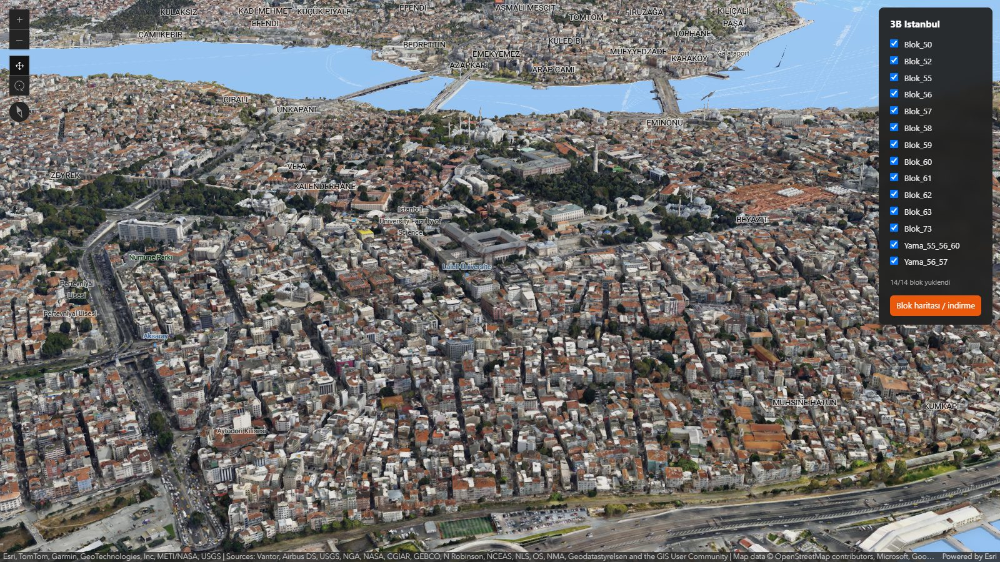
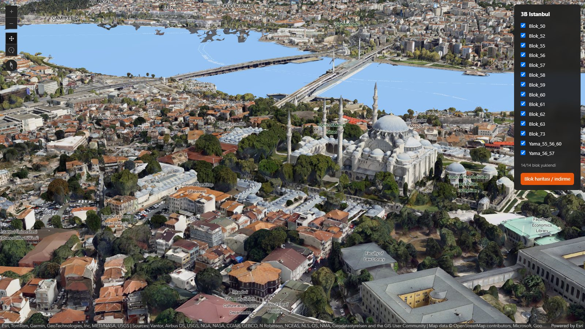
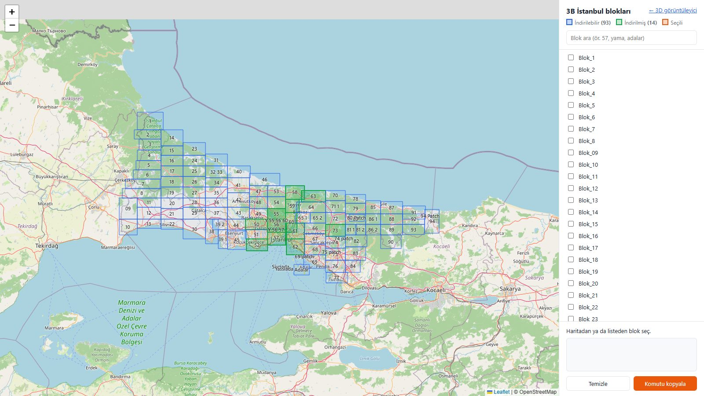

# 3B İstanbul

[Türkçe](README.md) | **English**

Downloads the Istanbul Metropolitan Municipality's (İBB) 3B İstanbul city model
(I3S / IntegratedMesh) block by block and views it locally in the browser.



## Requirements

- Disk space for the data: ~30 GB per block, ~3.3 TB in total
- **Docker** or **Python 3.10+** to run it

## Setup

```bash
git clone https://github.com/omerfarukaydin61/3bistanbul.git
cd 3bistanbul
cp .env.example .env
```

Set `DATA_DIR` in `.env` to the folder where the data will live (e.g. `D:/3bistanbul_3d`).
The downloader writes to this folder and the viewer reads from it.

## Running

### Docker

```bash
docker compose up -d --build
```

The interface is available at **http://localhost:8765** as long as the container is up;
it starts by itself when Docker starts. Stop it with `docker compose down`.

### Python

```bash
pip install -r requirements.txt
npm run dev            # = python viewer/serve.py
```

The `npm` shortcuts only call the Python commands; there is no Node dependency.

## Interface

**http://localhost:8765** — 3D viewer. Finds and loads the downloaded blocks in
`DATA_DIR`; blocks are toggled from the panel on the right. After downloading a new
block, reloading the page is enough.



**http://localhost:8765/blocks.html** — block map. Shows all 107 layers: downloaded
ones in green, downloadable ones in blue. Generates the download command for the
selected blocks.



## Downloading blocks

```bash
# Docker
docker compose exec viewer python downloader/download_3d.py --blocks 56 59

# Python
npm run download -- --blocks 56 59
```

- `--blocks` matches exactly: `57` → `Blok_57`; names such as `Yama_56_57` or `Adalar`
  match themselves. Without it, all layers are downloaded.
- Existing files are skipped; an incomplete block is finished by running the same command again.
- Do not run more than one download or `fetch_extents.py` at the same time: each one
  gets a new token and invalidates the other's.

## Helper scripts

| Command | What it does |
|---|---|
| `npm run extents` | Fetches the layer extents and rewrites `viewer/block_extents.json`. Run on the host, only when İBB's layer list changes. |
| `npm run clean-stubs -- --delete` | Finds and deletes `Invalid Token` responses that were saved in place of data during token errors (lists them only without `--delete`). |

The `viewer/` files are copied into the Docker image; after changing them, rebuild the
image with `docker compose up -d --build`.

## Source

The 3D city model belongs to İBB's **3B İstanbul** project:
https://3bistanbul.ibb.gov.tr/
