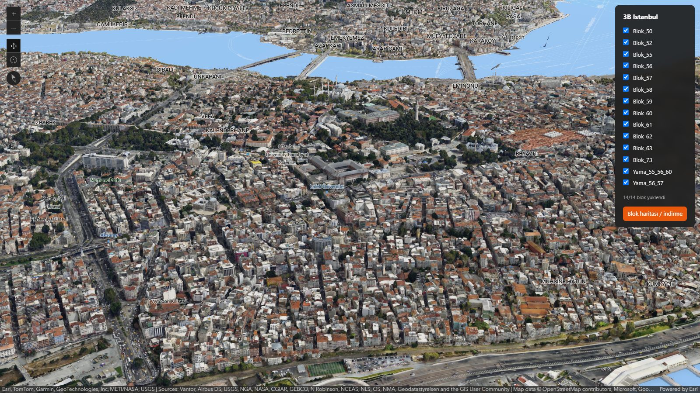
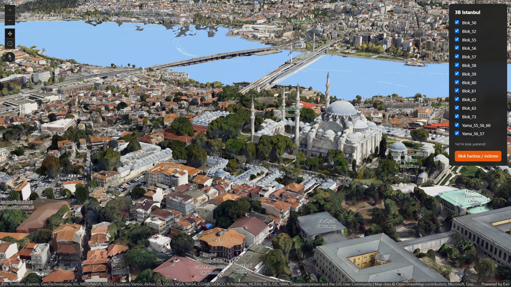
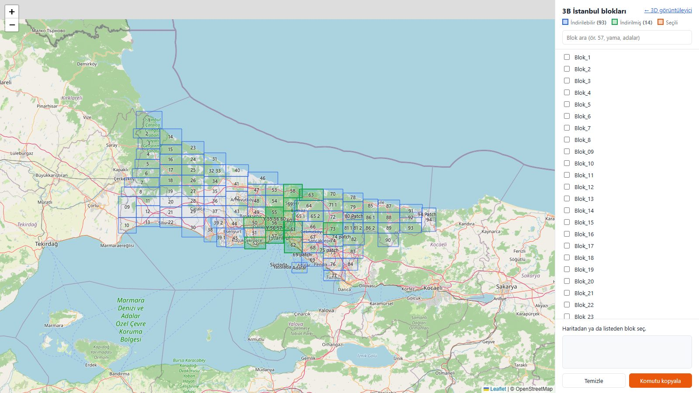

# 3B İstanbul

İBB'nin 3B İstanbul şehir modelini (I3S / IntegratedMesh) bloklar halinde indirip
tarayıcıda yerel olarak görüntüler.



## Gereksinimler

- Veri için disk alanı: blok başına ~30 GB, tamamı ~3.3 TB
- Çalıştırmak için **Docker** ya da **Python 3.10+**

## Kurulum

```bash
git clone https://github.com/omerfarukaydin61/3bistanbul.git
cd 3bistanbul
cp .env.example .env
```

`.env` içindeki `DATA_DIR`'a verinin duracağı klasörü yazın (örn. `D:/3bistanbul_3d`).
İndirici bu klasöre yazar, görüntüleyici buradan okur.

## Çalıştırma

### Docker

```bash
docker compose up -d --build
```

Arayüz container ayakta olduğu sürece **http://localhost:8765** adresinde açıktır;
Docker açılınca kendiliğinden başlar. Durdurmak için `docker compose down`.

### Python

```bash
pip install -r requirements.txt
npm run dev            # = python viewer/serve.py
```

`npm` kısayolları yalnızca Python komutlarını çağırır, Node bağımlılığı yoktur.

## Arayüz

**http://localhost:8765** — 3D görüntüleyici. `DATA_DIR`'daki indirilmiş blokları bulup
yükler; sağdaki panelden bloklar açılıp kapatılır. Yeni blok indirildiğinde sayfayı
yenilemek yeter.



**http://localhost:8765/blocks.html** — blok haritası. 107 katmanın tamamını gösterir:
indirilmişler yeşil, indirilebilirler mavi. Seçilen bloklar için indirme komutunu üretir.



## Blok indirme

```bash
# Docker
docker compose exec viewer python downloader/download_3d.py --blocks 56 59

# Python
npm run download -- --blocks 56 59
```

- `--blocks` tam eşleşme yapar: `57` → `Blok_57`; `Yama_56_57`, `Adalar` gibi adlar
  kendileriyle eşleşir. Verilmezse tüm katmanlar iner.
- Var olan dosyalar atlanır; yarım kalan bir blok aynı komutla tamamlanır.
- Aynı anda birden fazla indirme ya da `fetch_extents.py` çalıştırmayın: her biri yeni
  token alır ve diğerinin token'ını geçersiz kılar.

## Yardımcı scriptler

| Komut | Ne yapar |
|---|---|
| `npm run extents` | Katman kapsama alanlarını çekip `viewer/block_extents.json`'u yeniden yazar. Yalnızca İBB katman listesi değiştiğinde, host'ta çalıştırılır. |
| `npm run clean-stubs -- --delete` | Token hatası sırasında veri yerine kaydedilmiş `Invalid Token` dosyalarını bulur ve siler (`--delete` olmadan yalnızca listeler). |

`viewer/` dosyaları Docker imajına kopyalanır; değiştirildiklerinde
`docker compose up -d --build` ile imaj yeniden üretilir.
